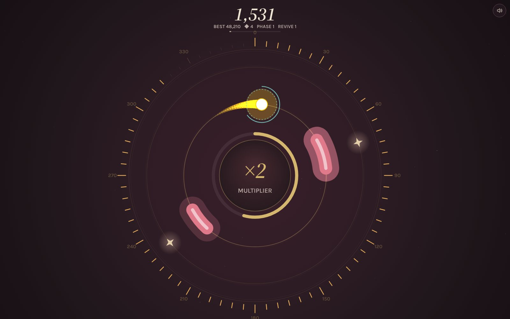

# Graze

**A one-tap orbit arcade game with a library of real courses.** Choose what you learn: ten languages, the sciences, medicine, math, logic, philosophy, the Bible and the great books. Learn it in short lessons, recall it at gates in the arcade game, and keep it in an endless Feed built to replace scrolling. Everything comes back on a spaced-review schedule until it sticks.

**[Play Graze](https://baney75.github.io/graze/play/)** · [Project site](https://baney75.github.io/graze/) · Made by [Donovan Baney](https://dbaney.com)



## What's in it

- **The Library.** 37 courses and about 18,300 items, in an order you choose: your first course is your focus and the rest mix in.
  - **Languages:** Spanish, French, German, Italian, Portuguese (Brazil), Polish, Latin, Greek (Koine and Classical), Japanese and Mandarin, from the alphabet to about A2.
  - **Sciences and medicine:** biology, general and organic chemistry, physics, engineering, anatomy and physiology, medical terminology and medicine.
  - **Math:** calculus, and mental math generated by code so every answer is computed.
  - **Mind:** logic and critical thinking, philosophy, psychology and the arguments for God.
  - **Reading:** the Bible, the Great Books, the Ancients (Plato, Aristotle, Plutarch, Thucydides) and advanced vocabulary.
  - **World and skills:** world geography with maps and flags, world history, grammar and style, research skills, strategy, martial arts and software engineering.
- **Lessons.** Eight new sigils at a time with examples, pictures and audio, then a quick check. Units with a reading start with it, and comprehension and pace are tracked.
- **The Feed.** A vertical, swipeable stream of due reviews, new sigils, speaking cards, quick math, readings and lesson notes, with combos, golden cards and milestones. Press F.
- **Pictures.** Diagram units (heart, neuron, brain, nephron, eye, lungs, animal and plant cells, the periodic table, functional groups), world and US maps, and 165 flags. They work in lessons, the Feed and at gates.
- **Speech.** Text-to-speech for every language item, plus pronunciation checks with the browser's speech recognition (Chrome, Edge and Safari), or record yourself and compare.
- **Arcade loop.** Grazes, perfect dodges, a multiplier up to ×8, Fever mode, shields, magnets, novas, bonus rushes, lane-hopping blocks, boons after each rush, quick-math gates, and a soundtrack that builds with your multiplier.
- **Recall gates.** Two-choice retrieval under light time pressure, with a recall-first pause before the answers appear, reverse gates for strong items, recall chains, and a recall revive when you crash.
- **Spaced review.** Each item moves through intervals of 10 minutes, then 1, 3, 7, 16, 35, 90 and 180 days. You set how many new items you get a day, from 5 to 30.
- **Progress.** Saved on your device. Transfer codes and backup files move it between devices and merge rather than overwrite. Inside Claude, it also keeps a cloud save and supports encrypted link codes.
- **Updates.** Installable and offline-capable on the web. New versions download in the background and wait for you to tap Update, and you see what changed once.

## Where the content comes from

Each course is written in original wording against free, reputable sources, which its course page and `courses/<key>/meta.json` list. The main ones are OpenStax and LibreTexts textbooks; COERLL (UT Austin) language courses; the Dickinson College Commentaries, Perseus and Wiktionary; MedlinePlus and the American Heart Association; the Stanford and Internet Encyclopedias of Philosophy; and Project Gutenberg, whose public-domain texts are quoted exactly. Every course was reviewed item by item before release, and most of the language and science courses also had a second, independent review. Report a mistake by opening an issue. `courses/SPEC.md` describes the format; `node scripts/check-course.mjs <key>` validates a course.

Maps come from Natural Earth (via `world-atlas`) and the US Census (via `us-atlas`), and flags from `flag-icons`. `npm run geo` regenerates `src/geo.js`.

## The science, briefly

Graze builds in what holds up: retrieval practice and spacing ([Dunlosky et al., 2013](https://www.psychologicalscience.org/news/releases/which-study-strategies-make-the-grade.html)), vocabulary and word roots, reading with comprehension checks ([Rayner et al., 2016](https://www.psychologicalscience.org/news/releases/speed-reading-promises-are-too-good-to-be-true-scientists-find.html)), if-then cues for a daily habit, saying words aloud (the production effect), and learning built into the core mechanic rather than bolted on ([Habgood & Ainsworth, 2011](https://shura.shu.ac.uk/3556/)). It leaves out brain-training IQ claims, which don't hold up ([Simons et al., 2016](https://news.illinois.edu/review-finds-little-evidence-that-brain-training-games-yield-real-world-benefits/)), and speed reading. Graze helps you remember what you practice; it makes no promise about intelligence.

## Working on it

[AGENTS.md](AGENTS.md) has the rules for working on Graze: architecture, card IDs, the save format, content standards and releasing. [PROJECT.md](PROJECT.md) has the idea, the decisions behind it, its history and the open ideas. [CLAUDE.md](CLAUDE.md) adds notes for Claude.

## Run it locally

Requires Node 18+ and nothing else.

```sh
npm test          # builds dist/ and runs the content and version checks
npm run serve     # builds, then serves dist/ at http://localhost:8080
```

`dist/index.html` is the project site, `dist/play/` is the game, and `dist/artifact.html` is the single-file copy published inside Claude.

## Releasing an update

1. Make the change in `src/` (or `site/` for the project page).
2. Add an entry at the top of `changelog.json` with a higher version, a date, a short name and a few notes. The version there is the single source of truth: the build stamps it into the game, the service worker, `play/version.json`, `package.json` and the project site.
3. Run `npm test`, commit and push to `main`. The Pages workflow builds, checks and deploys.

Players with the game open see an Update button within half an hour, or the next time they return to it. Their next run starts on the new version, and they see your notes once.

Save data carries a schema version (`v: 2`). If you change its shape, add the conversion in `normalize()` / `migrate()` in `src/core.js` so older saves keep working.

## Layout

```
courses/<key>/        one folder per course: meta.json and u01.json, u02.json, ...
courses/_diagrams/    picture units, merged into their courses at build time
src/
  shell.html          page structure and styles (Martyr Night palette)
  content-*.js        the original quick decks and the twenty Codex pages
  geo.js              generated world and US maps and flags
  diagrams-*.js       SVG diagrams with highlightable parts
  courses.js          the course registry and the mental math generator
  core.js             storage, mergeable save format, sync, crypto, review scheduler
  game-setup.js       constants, boons, workshop, trails, missions
  audio.js            sound effects, adaptive soundtrack, layout
  speech.js           text-to-speech, speech recognition and recording
  images.js           pictures for cards, on canvas and in the page
  game.js             gameplay, gates, boons, revive, menus and panels
  library.js          the Library, onboarding, lessons and speaking practice
  feed.js             the Feed
  updates.js          version checks, What's new, service worker wiring
  render.js           canvas drawing
  frame.js            focus overlay, frame loop, start-up
public/               service worker, manifest, icons
site/                 project page and screenshots
scripts/build.mjs     compiles courses and concatenates src/ into dist/
scripts/check.mjs     CI checks: script parses, courses are valid, pictures exist, versions agree
```

## License

MIT. Fonts are loaded from Google Fonts (Source Serif 4 and Karla, both under the SIL Open Font License).

## Sponsors

<!-- sponsors:start -->
No sponsors yet. [Sponsor on GitHub](https://github.com/sponsors/baney75) and your name appears here automatically.
<!-- sponsors:end -->
